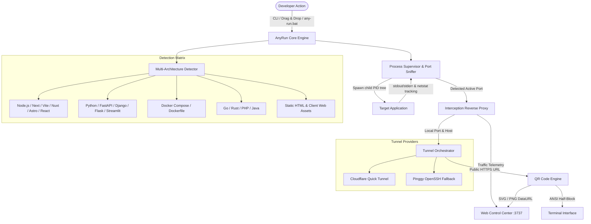

# AnyRun // One-Click Universal Project Runner, Tunnel & QR Gateway

[](https://github.com/any-run/any-run/actions/workflows/ci.yml)
[](https://opensource.org/licenses/MIT)
[](https://nodejs.org/)
[](CONTRIBUTING.md)

**AnyRun** is an autonomous, one-click developer utility that inspects, configures, and launches projects across any software architecture, dynamically detects the listening port, establishes an instant public HTTPS tunnel, and displays scannable QR codes in both your terminal and a local web control dashboard.

---

## Architecture Overview



---

## Table of Contents

- [1. Quick Start](#1-quick-start)
  - [Method A: Double-Click or Drag & Drop (Windows)](#method-a-double-click-or-drag--drop-windows)
  - [Method B: Command-Line Interface](#method-b-command-line-interface)
  - [Method C: Interactive Web Control Center](#method-c-interactive-web-control-center)
- [2. CLI Usage & Options](#2-cli-usage--options)
- [3. Interactive Terminal Shortcuts](#3-interactive-terminal-shortcuts)
- [4. Dual-Mode QR & Access Links](#4-dual-mode-qr--access-links)
- [5. Web Control Center Features](#5-web-control-center-features)
- [6. Multi-Architecture Detection Matrix](#6-multi-architecture-detection-matrix)
- [7. How Port Detection Works](#7-how-port-detection-works)
- [8. Deep Traffic Inspection & Request Replay](#8-deep-traffic-inspection--request-replay)
- [9. REST API & SSE Specifications](#9-rest-api--sse-specifications)
- [10. Production & Security Hardening](#10-production--security-hardening)
- [11. Verification & Testing](#11-verification--testing)

---

## 1. Quick Start

### Method A: Double-Click or Drag & Drop (Windows)
1. **Launch Dashboard**: Double-click `any-run.bat` to launch the background control server and open your browser dashboard.
2. **Instant Run via Drag & Drop**: Drag **any project folder** from Windows Explorer directly onto `any-run.bat`. AnyRun detects the runtime, installs dependencies if missing, detects the port, creates an HTTPS tunnel, and prints the QR code.

### Method B: Command-Line Interface
Run directly without pre-configuration:
```bash
# Global install (optional)
npm install -g any-run

# Run any project directory:
any-run /path/to/project

# With port or provider overrides:
any-run ./my-api --port 8000 --tunnel cloudflare
```

### Method C: Interactive Web Control Center
```bash
# Launch the dashboard standalone:
npm start
```
Open `http://localhost:3737` to browse local drives, select folders, view live terminal logs, and monitor HTTP traffic.

---

## 2. CLI Usage & Options

```text
USAGE:
  any-run [project-path] [options]

OPTIONS:
  --port <number>             Target application port override
  --tunnel <cloudflare|pinggy|auto> Tunnel provider (default: auto)
  --web-port <number>         Web Control Center port (default: 3737)
  --no-open                   Do not automatically launch the default browser
  --auto-exit                 Terminate AnyRun when the Web Control Center browser tab closes
  --help, -h                  Display help manual

EXAMPLES:
  any-run                     Start the Web Control Center on port 3737
  any-run ./my-react-app      Detect, run, tunnel, and display QR for React
  any-run D:\backend\fastapi  Run Python FastAPI with auto-detected .venv
```

---

## 3. Interactive Terminal Shortcuts

When running AnyRun in a TTY terminal, interactive hotkeys are active:

| Key | Action | Description |
| :---: | :--- | :--- |
| <kbd>o</kbd> | **Open Public Tunnel** | Opens the public HTTPS tunnel link in your default browser |
| <kbd>l</kbd> | **Open Control Center** | Opens the local Web Control Center (`http://localhost:3737`) |
| <kbd>r</kbd> | **Restart Application** | Stops the current process tree and re-runs the launch sequence |
| <kbd>c</kbd> | **Copy Tunnel URL** | Copies the public `trycloudflare.com` URL to the clipboard |
| <kbd>w</kbd> | **Copy Wi-Fi URL** | Copies the direct local LAN IP URL (`http://192.168.x.x:port`) |
| <kbd>h</kbd> | **Show Help** | Displays the shortcut hotkey manual in the terminal |
| <kbd>q</kbd> | **Quit** | Gracefully terminates child processes, tunnels, and exits |

---

## 4. Dual-Mode QR & Access Links

Every running project receives two separate access pathways:

```text
  ✔ ANYRUN GATEWAY ACTIVE
  --------------------------------------------------------
  ➜  Architecture:  Node.js (Vite)
  ➜  Local Service: http://localhost:5173
  ➜  Local Wi-Fi:   http://192.168.1.40:6173 (Fastest on same network)
  ➜  Public Tunnel: https://random-subdomain.trycloudflare.com
  --------------------------------------------------------
```

1. **Local Wi-Fi (LAN Direct - Zero Latency)**:
   - Format: `http://<local-ip>:<gateway-port>`
   - Direct connection over your local network router.
   - **Zero DNS latency**: Not subject to ISP DNS caching, TTL delays, or regional DNS filters.
   - Ideal for testing responsive UI directly on physical phones or tablets on the same Wi-Fi.

2. **Public HTTPS Tunnel (Worldwide Access)**:
   - Format: `https://<hash>.trycloudflare.com`
   - Global reachability over 4G/5G mobile data and remote environments.
   - Free SSL termination with zero user accounts or configuration required.
   - Automatically downloads the portable `cloudflared` binary on first use, with OpenSSH (`a.pinggy.io`) fallback.

---

## 5. Web Control Center Features

The local dashboard at `http://localhost:3737` provides a complete developer control interface:

- **Tactile Telemetry Bar**: Real-time status indicators, process uptime, system RAM usage, active port binding, and tunnel latency ping.
- **Visual File Navigator**: Multi-drive file browser (`C:\`, `D:\`, `E:\`, `/`) with directory filtering and folder drag-and-drop.
- **Recent Projects**: One-click quick-launch chips for previously opened directories.
- **High-Resolution QR Hub**: Instant toggle between Public Tunnel and Local Wi-Fi QR codes, with one-click URL copying and PNG QR image download.
- **Responsive Device Simulator Modal**:
  - Interactive iframe simulator with realistic phone frames.
  - Presets: iPhone 15 Pro, iPhone SE, Google Pixel 7, iPad Mini.
  - Portrait and landscape orientation rotation, plus hard refresh controls.
- **Live Terminal Console**: Real-time log streaming with instant text search, error highlighting, and autoscroll locking.
- **Silent Background Launcher (`any-run.vbs`)**: Windows VBScript launcher that runs without keeping a terminal window open and automatically cleans up when the browser tab closes.

---

## 6. Multi-Architecture Detection Matrix

AnyRun analyzes project signatures and constructs the optimal startup configuration:

| Architecture | Signature Files | Detection Logic & Port Resolution | Default Port |
| :--- | :--- | :--- | :---: |
| **Next.js** | `package.json` (`next`) | `npm run dev` / `yarn dev` / `pnpm dev` | `3000` |
| **Vite** | `package.json` (`vite`) | Parses `vite.config.{ts,js}` for port overrides | `5173` |
| **Angular** | `package.json` (`@angular/core`) | `npm start` | `4200` |
| **Astro** | `package.json` (`astro`) | `npm run dev` | `4321` |
| **SvelteKit** | `package.json` (`@sveltejs/kit`) | `npm run dev` | `5173` |
| **Nuxt** | `package.json` (`nuxt`) | `npm run dev` | `3000` |
| **Remix** | `package.json` (`@remix-run/react`) | `npm run dev` | `3000` |
| **Create React App** | `package.json` (`react-scripts`) | `npm start` | `3000` |
| **Node.js (Backend)** | `package.json`, `server.js` | Inspects `dev`, `start`, or falls back to `node server.js` | `3000` |
| **Python (FastAPI)** | `main.py`, `app.py` (`fastapi`) | Auto-detects `.venv` / `venv` / `env`; `uvicorn main:app --reload` | `8000` |
| **Python (Django)** | `manage.py` | `manage.py runserver 0.0.0.0:8000` | `8000` |
| **Python (Flask)** | `app.py`, `wsgi.py` (`flask`) | `flask run --host 0.0.0.0 --port 5000` | `5000` |
| **Python (Streamlit)** | `main.py` (`streamlit`) | `streamlit run <file> --server.port 8501` | `8501` |
| **Python (Gradio)** | `app.py` (`gradio`) | `python <file>` | `7860` |
| **Docker Compose** | `compose.yaml`, `docker-compose.yml` | Parses exposed ports; `docker compose up` | `8080` |
| **Dockerfile** | `Dockerfile` | Parses `EXPOSE`; builds and runs container | `8080` |
| **Go** | `go.mod`, `main.go` | `go run .` | `8080` |
| **Rust** | `Cargo.toml` | `cargo run` | `8080` |
| **PHP (Laravel)** | `artisan` | `php artisan serve --host 0.0.0.0 --port 8000` | `8000` |
| **PHP (Built-in)** | `index.php` | `php -S 0.0.0.0:8000` | `8000` |
| **Java (Spring / Maven)** | `pom.xml` | `mvn spring-boot:run` | `8080` |
| **Java (Gradle)** | `build.gradle`, `gradlew.bat` | `gradle bootRun` | `8080` |
| **Static HTML / SPA** | `index.html`, HTML/CSS/JS | Built-in zero-dependency high-speed static server | `5000` |

---

## 7. How Port Detection Works

Dev servers often shift ports dynamically (for example, Vite shifting from `5173` to `5174` if `5173` is busy). AnyRun resolves ports through a 3-layer sniffer:

1. **Log Output Stream Parsing**: Captures explicit port announcements (`Local: http://...:PORT`, `listening on port PORT`, `Uvicorn running on ...`). It discards "Port XXX is in use" noise to extract the true assigned port.
2. **Process Socket Tracking**: Queries the child process PID tree via `netstat` (Windows) or `lsof` (Unix) to find open listening TCP sockets belonging directly to the spawned process.
3. **Stale Port Cleanup**: If a previous crashed run leaves a port locked, AnyRun automatically terminates stale zombie processes holding that port before starting.

---

## 8. Deep Traffic Inspection & Request Replay

AnyRun includes an in-memory HTTP/WebSocket reverse proxy between incoming traffic and your dev server:

- **Live Request Ledger**: Logs HTTP method, URL path, HTTP status code (color-coded), client IP, duration in milliseconds, and timestamp.
- **Full Header Capture**: Inspect incoming headers (`User-Agent`, `Authorization`, `Accept`) and upstream response headers.
- **WebSocket Relay**: Bidirectional streaming proxy for Vite HMR, Next.js Fast Refresh, and socket connections with automatic connection cleanup.
- **Interactive Request Replay**: Click **Replay** on any captured request to re-fire it against the local service with custom headers and body, displaying the upstream response status and body preview directly in the UI.
- **Copy as cURL**: Generate reproducible `curl` commands from any captured network request with a single click.

---

## 9. REST API & SSE Specifications

The Web Control Center server exposes a clean JSON API:

| Endpoint | Method | Description |
| :--- | :---: | :--- |
| `/api/events` | `GET` | Server-Sent Events (SSE) stream for status, logs, requests, and telemetry |
| `/api/status` | `GET` | Returns current runner state, URLs, ports, and system metrics |
| `/api/logs` | `GET` | Returns rolling terminal log buffer (up to 2,000 entries) |
| `/api/requests` | `GET` | Returns rolling intercepted network request history (up to 500 entries) |
| `/api/scan` | `POST` | Inspects directory `{ "path": "/path/to/project" }` and returns detected config |
| `/api/run` | `POST` | Starts execution for `{ "path": "...", "port": 3000, "tunnel": "auto" }` |
| `/api/stop` | `POST` | Stops all active processes, tunnels, and proxies |
| `/api/restart` | `POST` | Performs graceful teardown and re-executes the current project |
| `/api/browse` | `GET` | File system navigator (`?dir=/path` or `?dir=drives`) |
| `/api/locate-folder` | `POST` | Finds matching folder path from a dropped folder name |
| `/api/replay` | `POST` | Replays an HTTP request `{ "method": "GET", "path": "/api", "headers": {} }` |
| `/api/shutdown` | `POST` | Shuts down the background AnyRun control server |

---

## 10. Production & Security Hardening

- **Boundary Validation**: Path traversal attempts (e.g. `/../../etc/passwd` or `%c0%af`) are intercepted and returned as `403 Forbidden` / `400 Bad Request`.
- **SSRF Prevention**: The request replay engine is strictly bound to `127.0.0.1` and validated integer ports, preventing internal network scanning.
- **Resource Discipline**: Rotating in-memory ring buffers cap logs (2,000 entries) and requests (500 entries) to maintain low memory usage.
- **Cross-Platform Process Termination**: Uses `taskkill /pid <PID> /f /t` on Windows and detached process groups (`process.kill(-pid, 'SIGKILL')`) on Linux/macOS to eliminate orphaned child processes.
- **Atomic Executable Provisioning**: Tunnel binaries download to temporary files and verify file size integrity before atomic replacement.

---

## 11. Verification & Testing

AnyRun contains an automated self-check test suite testing port sniffing, QR generation, architecture detection, static serving, path traversal security, and the interception proxy:

```bash
# Run test suite
npm test
```

### Self-Check Suite Results
```text
>>> Starting AnyRun Self-Check Suite...

Testing port sniffer regex extraction...
  [PASS] Port sniffer collision extraction verified.

Testing QR code generators...
  [PASS] QR generation (Terminal, DataURL, SVG) verified.

Testing architecture detection matrix...
  [PASS] Node.js (Vite) custom port detection verified.
  [PASS] Python (FastAPI) detection verified.
  [PASS] Static HTML detection verified.
  [PASS] Python project-local virtual environment (.venv) detection verified.

Testing embedded static HTTP server & security protections...
  [PASS] Embedded static HTTP server and path traversal / malformed URI protections verified.

Testing Web Control Server endpoints...
  [PASS] Web Control Server, drives browse, /api/replay, and /api/locate-folder verified.

Testing zero-dependency Interception Reverse Proxy...
  [PASS] Interception Reverse Proxy & deep traffic inspection verified.

>>> All AnyRun self-checks PASSED successfully!
```

---

## License

MIT © [AnyRun Contributors](LICENSE)
