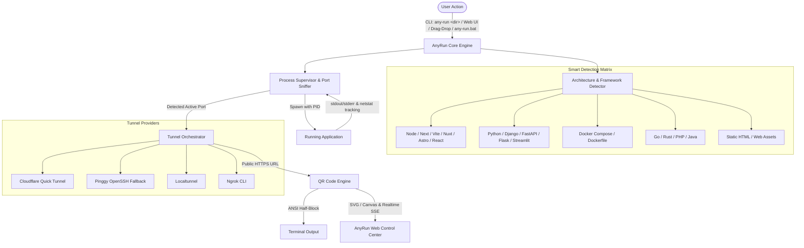

# Implementation Plan: AnyRun - One-Click Universal Project Runner & Tunnel System

Build **AnyRun**, a high-performance, one-click system that inspects, configures, and launches any project of any software architecture, dynamically detects the listening port, establishes an instant public HTTPS tunnel, and displays an scannable QR code both in the terminal and in a web control dashboard.

## User Review Required

> [!IMPORTANT]
> **Tunnel Providers & Zero-Config Operation**:
> 1. **Cloudflare Quick Tunnels (`trycloudflare.com`)**: Primary provider. 100% free, zero configuration, no login or account required, HTTPS with SSL. The system automatically downloads the official standalone `cloudflared.exe` binary into `.bin/` on first use if not already in PATH.
> 2. **Pinggy (`a.pinggy.io`) via OpenSSH**: Instant fallback that uses the native Windows OpenSSH (`ssh.exe` already present on your machine) without requiring any binary download.
> 3. **Localtunnel & Ngrok**: Supported as additional tunnel backends (user can switch in settings or dashboard).
>
> Please verify if automatic downloading of the portable `cloudflared.exe` is acceptable, or if you prefer pure native SSH / Pinggy as default. (Both will be supported seamlessly).

## System Architecture

## Proposed Changes

### Core Engine & Architecture Detector (`e:\any-run\`)

#### [NEW] [package.json](file:///e:/any-run/package.json)
- Project manifest specifying dependencies (`ws`, `qrcode`, `chalk`, `open`, etc.).
- Executable binary command definition (`bin: { "any-run": "./bin/any-run.js" }`).

#### [NEW] [bin/any-run.js](file:///e:/any-run/bin/any-run.js)
- CLI entrypoint supporting:
  - `any-run` (starts Web Control Center at `http://localhost:3737`).
  - `any-run <path>` (launches the specified project, initiates tunnel, outputs terminal QR, and opens dashboard).
  - Flags: `--port`, `--tunnel [cloudflare|pinggy|localtunnel]`, `--no-open`, `--help`.

#### [NEW] [any-run.bat](file:///e:/any-run/any-run.bat)
- Windows double-click launcher supporting drag-and-drop of any project folder directly onto the file or instant one-click execution.

#### [NEW] [src/detector.js](file:///e:/any-run/src/detector.js)
- Multi-architecture detector analyzing:
  - **Node.js**: Next.js, Vite, Nuxt, Astro, Remix, SvelteKit, Create React App, Express, NestJS, etc. Parses `package.json` scripts (`dev`, `start`, `serve`).
  - **Python**: Django (`manage.py`), FastAPI (`uvicorn`), Flask, Streamlit, Gradio, generic `main.py` / `app.py`.
  - **Docker**: `docker-compose.yml`, `compose.yaml`, `Dockerfile`.
  - **Go**: `go.mod`, `main.go`.
  - **Rust**: `Cargo.toml`.
  - **PHP**: `artisan` (Laravel), `index.php`.
  - **Java/Kotlin**: `pom.xml`, `build.gradle`.
  - **Static**: `index.html` and static client directories (instantiates built-in zero-dependency HTTP server).
- Returns execution plan: binary command, args, environment variables, suggested default port, package manager.

#### [NEW] [src/port_sniffer.js](file:///e:/any-run/src/port_sniffer.js)
- Detects the actual bound local TCP port via:
  1. Regex capture on child process stdout/stderr stream (`localhost:PORT`, `127.0.0.1:PORT`, `port PORT`).
  2. Windows native socket inspection via `netstat -ano -p tcp` tied to child process PID tree.
  3. Pre-assigned `PORT` environment variable validation.

#### [NEW] [src/tunnel.js](file:///e:/any-run/src/tunnel.js)
- Provider abstraction for zero-config public tunneling:
  - **Cloudflare**: Manages portable `cloudflared.exe` in local `.bin/` cache, launches ephemeral tunnel `cloudflared tunnel --url http://127.0.0.1:<port>`, parses public `https://*.trycloudflare.com` URL.
  - **Pinggy**: Launches `ssh -o StrictHostKeyChecking=no -p 443 -R0:localhost:<port> a.pinggy.io`, extracts HTTPS link.
  - **Localtunnel / Ngrok**: Fallbacks when requested.

#### [NEW] [src/qr.js](file:///e:/any-run/src/qr.js)
- Terminal ANSI QR code generator (crisp, high-contrast, compact UTF-8 blocks).
- Web SVG/DataURL QR code generator for the browser interface.

#### [NEW] [src/server.js](file:///e:/any-run/src/server.js)
- Lightweight local management server serving the Web Control Center and handling:
  - WebSocket / SSE for real-time log streaming.
  - REST endpoints for folder picking, architecture scanning, starting, stopping, restarting, and changing tunnel providers.

#### [NEW] [src/ui/index.html](file:///e:/any-run/src/ui/index.html) & [src/ui/app.js](file:///e:/any-run/src/ui/app.js) & [src/ui/style.css](file:///e:/any-run/src/ui/style.css)
- Precision Swiss-industrial Web Control Center adhering strictly to frontend design rules:
  - **Design Read**: Precision Swiss-industrial workbench with tactile amber-tinted graphite surfaces, crisp Geist typography, and micro-engineered status telemetry.
  - **Components**:
    - **Header**: System status, active tunnel latency ping, quick actions.
    - **Project & Architecture Card**: Folder path selector, auto-detected runtime badge, command preview, port override.
    - **Live Tunnel & QR Hub**: High-res QR code, copyable tunnel URL, open in browser button, mobile frame simulator preview toggle.
    - **Streaming Console**: Real-time terminal output with search, clear, and autoscroll.
    - **Process Controls**: Start, Stop, Restart, Re-detect buttons with clean tactile downstates.
  - No emojis, Phosphor SVG icons, WCAG AA contrast, warm graphite palette (`#0c0d0e`, `#151719`, `#202327`, `#e5e7eb`, accent amber `#f59e0b` at <80% saturation).

## Verification Plan

### Automated & Unit Verification
- Test detector across multiple sample fixtures:
  - Node.js (Vite / Next.js) mock project.
  - Python (FastAPI / Flask / Simple HTTP) mock project.
  - Static HTML site mock project.
- Test port sniffer regex and PID socket listener resolution.
- Test QR generator output in console and SVG generation.

### End-to-End Manual Verification
1. Run `node bin/any-run.js` in a test project directory.
2. Verify architecture auto-detection accurately identifies the project.
3. Verify the project launches and binds to its port.
4. Verify tunnel URL is obtained and valid via an external HTTP request.
5. Verify QR code displays cleanly in the terminal.
6. Verify the Web Control Center opens automatically, displays the live QR code, logs, and mobile simulator preview.
7. Test the double-click `any-run.bat` launcher.
